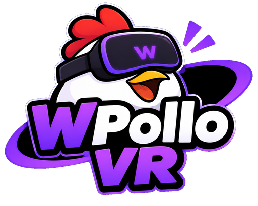

# Wpollo VR

VR para **Oculus Go** (site WebXR) e para **celular no VR Box** (site ou APK). Inclui 62 jogos, ambientes
fotográficos, hand tracking por câmera, realidade mista, Joy-Con, multitarefa e um mensageiro próprio.

> O logo é do autor do projeto. Não há afiliação com Meta, Roblox, WhatsApp ou qualquer marca citada.

## Duas versões

| | **Site** | **APK** |
|---|---|---|
| Para | Oculus Go (Oculus Browser), Quest, PC, celular | celular Android num VR Box |
| Como | GitHub Pages: abra o link e toque em **Entrar no VR** | instale `WpolloVR.apk` (gerado pelo Actions, veja abaixo) |
| Hand tracking | ONNX Runtime Web: WebNN NPU > WebGPU > CPU | **nativo: ONNX Runtime Android + NNAPI** (usa a NPU/DSP) |
| 6DoF | ARCore pelo WebXR (Chrome Android) | — (o WebView do Android não tem WebXR); use o site no Chrome |
| Offline | depois da 1ª visita (service worker) | sempre (tudo dentro do APK) |

## Modo VR Box (celular)

A **única tela 2D** do Wpollo VR é a configuração inicial do VR Box. Depois disso, tudo acontece em 3D.

- **Cabeça:** 3DoF pelo sensor de orientação a 120 Hz, com predição de movimento ajustável. Opção de **6DoF via
  ARCore** para andar de verdade.
- **Render estéreo** lado a lado com distorção de lente opcional (barril). Distância entre os olhos, campo de
  visão e resolução são ajustáveis.
- **Realidade mista:** a câmera traseira vira o fundo. O céu e o chão virtuais somem e os objetos ficam no seu
  ambiente real.
- **Lanterna:** liga e desliga pela central de controle (torch da câmera; ponte nativa no APK).
- **Sem controle:** olhe para um botão por 1,3 s para clicar (o cursor cresce), ou toque na tela (botão do VR Box).
- **Joy-Con e controles Bluetooth (só botões, sem giroscópio):**
  - R/ZR/A/B = gatilho da mão direita, L/ZL = gatilho da esquerda.
  - +/−/Home = menu; analógico ou setas = andar e girar.
  - Com um controle conectado, a pinça não clica. A mão rastreada continua dando a posição e a direção do ponteiro.

### Hand tracking (sem MediaPipe)

- **Modelos:** RTMDet-nano (detecta mãos) + RTMPose-m hand (21 pontos), ambos da OpenMMLab (Apache-2.0).
  Foram convertidos para **fp16** (NPU/GPU), **int8** (CPU) e **fp32** (NNAPI no APK).
- **Otimizações:**
  - O detector roda só a cada N quadros; entre eles, a caixa da mão é rastreada pelos pontos do quadro anterior.
  - Só um quadro é processado por vez, e os atrasados são descartados (sem fila = latência mínima).
  - A inferência roda numa **thread separada** (Worker) ou na principal, à sua escolha.
- **Aceleradores:** NPU (WebNN no site / NNAPI no APK), GPU (WebGPU) ou CPU (WASM SIMD int8). Se o escolhido
  não existir no aparelho, o próximo da lista é usado e a tela mostra qual está ativo.
- **Filtros:** One Euro, Kalman (velocidade constante), média exponencial ou nenhum, todos com predição em ms.
- **Visual:** luvas sem dedos nos estilos **Clássico** e **Fofinho (peludinho)**, com cor ajustável.
  São 4 draw calls por mão.
- **Gestos:** pinça = clicar; pinça longa da mão esquerda = menu.
- **3D:** a profundidade é estimada pelo tamanho da mão na imagem. O modelo dá pontos 2D, então a profundidade
  dos dedos é uma aproximação.

### Sensores e latência (VR Box)

- **Fusão própria** dos sensores do celular:
  - giroscópio integrado a 200 Hz;
  - o acelerômetro corrige a inclinação (gravidade);
  - o magnetômetro corrige a deriva do giro no eixo vertical (dá para desligar perto de metais).
- **Predição** pela velocidade angular medida, compensando o tempo até a imagem chegar aos olhos.
- **Aceleração da cabeça** nos jogos (`REGO.headAccel`). Pular de verdade faz pular nos obbies, e inclinar ou
  agachar move a câmera alguns centímetros.
- **Altura da cabeça até o chão:** no APK, usa o **barômetro** (Altura (chão) na central de controle: primeiro o
  celular no chão, depois na cabeça). O magnetômetro mede campo magnético, não distância, então não serve para isso.
- **Latência:**
  - canvas WebGL `desynchronized` (o quadro vai direto para a tela, sem a fila de composição);
  - service worker que busca o código na rede primeiro (nunca mistura versões) e guarda os assets pesados em cache.

### Vídeos, Navegador e Apps Android

- **Vídeos (YouTube por código aberto):**
  - APK: **NewPipeExtractor**, que busca e extrai direto no aparelho, sem conta.
  - Site: instâncias **Invidious/Piped**. As públicas costumam bloquear; dá para usar a sua própria.
  - Modos de exibição: **Cinema** (cinema real em 360° com o telão encaixado), **Sala cinza** (obra de concreto
    vazia, foto real) e **360°**.
- **Navegador:**
  - APK: uma página real (WebView fora da tela) aparece dentro do VR, com toque, rolagem, teclado e
    voltar/avançar, mais o botão **Wolvic** para abrir no navegador XR aberto.
  - Oculus Go: o Wolvic não roda nele; os sites WebXR abrem em tela cheia.
- **Apps Android em janelas (APK + Shizuku, experimental):**
  - O Shizuku dá permissão de shell sem root: ativa janelas livres, força apps redimensionáveis e abre cada app
    num **display virtual próprio** (MediaProjection).
  - A janela no VR pode ser Retrato, Paisagem ou Tablet, e várias ficam abertas ao mesmo tempo.
  - Toques, rolagem, texto e Voltar/Início são enviados por `input -d <display>`.
  - Requisitos: app **Shizuku** instalado e iniciado, e aceitar a captura de tela uma vez.
- **Tela cheia:** botão na central de controle (VR Box) e botão de maximizar em cada janela, em qualquer modo.
- **Toque direto com o indicador:** encoste a ponta do dedo nos painéis, como numa tela. Um comitê de 6 detectores
  vota para confirmar o clique:
  1. o dedo atravessou o plano do painel (obrigatório);
  2. a deriva lateral ficou abaixo de 2,5 cm, para não confundir com arrasto (obrigatório);
  3. havia velocidade em direção ao painel;
  4. o indicador estava esticado;
  5. os outros dedos estavam dobrados;
  6. o modelo estava confiante nos pontos do dedo.

  São precisos pelo menos 5 votos, e o dedo precisa recuar antes do próximo toque. Perto de um painel, o
  rastreador entra em **modo foco**: desliga o detector, processa só a mão que aponta (na NPU, quando houver) e usa
  um recorte mais justo, para mais precisão e menos latência. Um anel mostra onde o dedo vai tocar; com o APK, o
  celular vibra a cada toque.
- **Mãos rastreadas realistas:** a malha de mão articulada com pele é movida pelos 21 pontos rastreados. Estilos:
  pele, luva cortada Clássica ou Fofinha (pelúcia só nas áreas da luva).

## Interface

O Início tem três painéis em volta de você, no estilo da referência:
- **Menu lateral** (Início, Biblioteca, Modelos de mãos, Ambiente, Vídeo, Capturas, Ajustes, Sobre).
- **Conteúdo**, com os "jogados recentemente" e os apps.
- **Central de controle**, com hora, bateria, Captura, Centralizar, Lanterna, Realidade mista, Mãos, FPS,
  volume e brilho.

Ícones de linha **Lucide**; cor de destaque no roxo do logo.

**Ambientes:** fotos 360° reais de salas (apartamento com vista para o mar, sala de estar, lounge clássico) e
cenários externos. As salas são projetadas numa caixa, então chão e paredes aparecem na profundidade certa em estéreo.

## Wpollo Chat

Mensageiro próprio: login por **username**, sem número de telefone. Tem conversas 1:1, grupos, envio de imagens
(capturas do VR), respostas rápidas, "digitando…", online e não lidas, tudo em tempo real.
O servidor fica em [`server/chat`](server/chat/README.md) e é você quem hospeda.

## Jogos (62)

- **Destaques:** Boliche VR (física real), **Sandbox Lab** (laboratório industrial no estilo BoneLab), Blocky World,
  Neon Beats, Kart Turbo, Labirinto Inclinável, Pintura 3D, Construtor de Blocos e outros.
- **Sandbox Lab:**
  - Sala de concreto com faixas de perigo, símbolos de radiação, luzes de alerta giratórias, estantes e tambores
    radioativos.
  - **Pistola** com clarão, recuo, cápsulas ejetadas e marcas de tiro; **marreta** por balanço do pulso.
  - Bonecos de teste articulados com **sangue** (jatos que caem e mancham chão, paredes e o próprio boneco).
  - Ferramentas de puxar à distância, criar objetos reais (CC0), TNT em cadeia, dominós, congelar e apagar.
- **Modelos e cenários:** objetos reais do Poly Haven (CC0), otimizados para o Go, com mãos (MIT) segurando o
  controle e céus fotográficos.

## Publicar

- **Site:** em Settings → Pages → Source escolha **GitHub Actions** (workflow `pages.yml`).
- **APK:** o workflow `apk.yml` compila a cada push e deixa o arquivo em **Actions → execução → Artifacts**.
  Ele **não** publica em Releases.
- Para compilar localmente: `cd android && gradle assembleRelease` (JDK 17 + Android SDK 34).

## Ferramentas

- `tools/build-assets.mjs`: baixa e otimiza modelos, texturas e céus CC0. Rode com `cd tools && npm i && node build-assets.mjs`.
- `tools/dev/`: páginas de teste (pose das mãos, hand tracking com imagem).

## Licenças

Veja [`assets/LICENSES.md`](assets/LICENSES.md) e [`assets/CREDITS.json`](assets/CREDITS.json).
